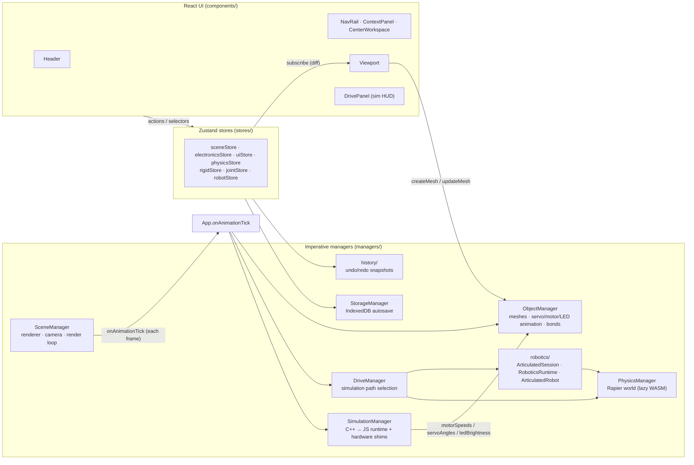
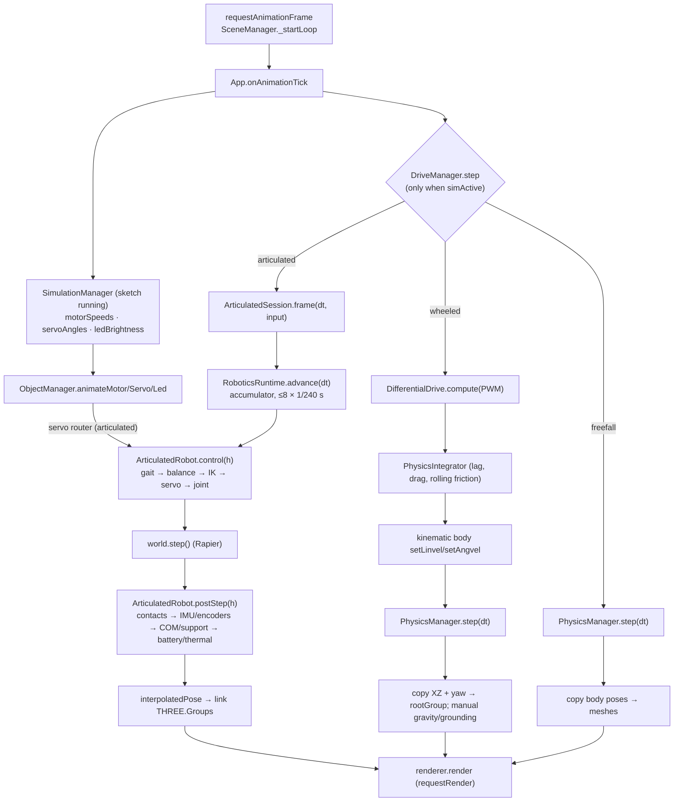
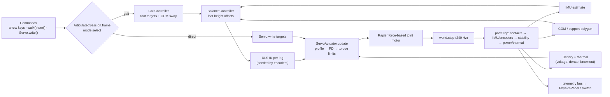
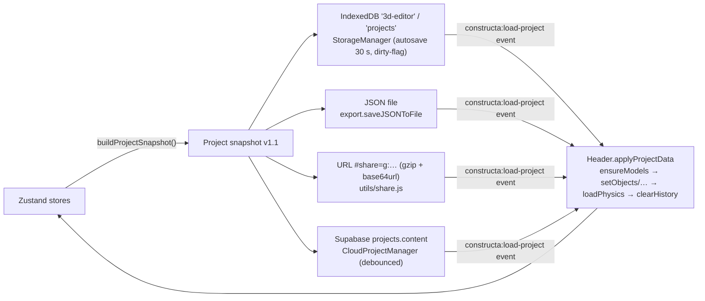
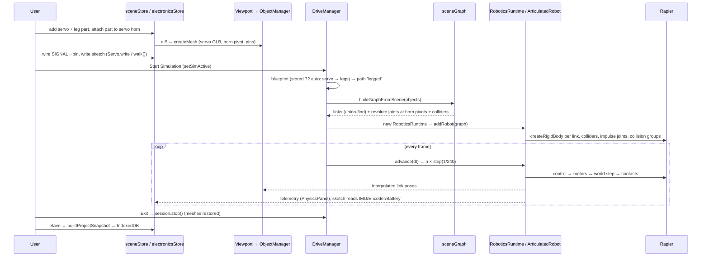

# Constructa — Project Documentation

> **Scope.** This document describes the Constructa editor in this repository (`toolsapp`, internal build name *Imaginarium*), as it exists in the source code on **2026-10-17** (branch `updated_ui`, commit `2d5435a`). It was written by reading the code and following imports and calls; every behaviour described here is traced to a file and function. The separate landing / user-dashboard app (`constructa-page.atumx.in`, its own repository) is mentioned only where the editor depends on it.
>
> **Status labels used throughout**
>
> | Label | Meaning |
> |---|---|
> | ✅ **Implemented** | Working functionality supported by the code (and, where noted, by automated tests). |
> | 🟡 **Partial** | Some functionality exists; important parts are incomplete or approximate. |
> | 🧩 **Placeholder** | UI, interfaces, comments or stubs exist without a working implementation. |
> | 💤 **Dormant** | Working code that the mounted UI can no longer reach. |
> | ❌ **Not found** | No supporting implementation was identified. |
>
> A statement marked *(inferred)* was derived from reading the code but not observed by running it.

---

## Table of contents

1. [Project overview](#1-project-overview)
2. [Technology stack and repository layout](#2-technology-stack-and-repository-layout)
3. [Feature inventory](#3-feature-inventory)
4. [Physics engine — detailed explanation](#4-physics-engine--detailed-explanation)
5. [Rendering, performance and memory](#5-rendering-performance-and-memory)
6. [State management and persistence](#6-state-management-and-persistence)
7. [File-by-file developer reference](#7-file-by-file-developer-reference)
8. [Internal APIs, interfaces and data flow](#8-internal-apis-interfaces-and-data-flow)
9. [Running, testing and debugging](#9-running-testing-and-debugging)
10. [Known issues and future work](#10-known-issues-and-future-work)

---

## 1. Project overview

**Constructa** is a browser-based robotics workshop. A user:

1. **Designs** a robot in a Tinkercad-style 3D CAD editor (primitives, booleans, imported models, built-in electronics models).
2. **Assembles** it — bonding parts together, attaching wheels/arms to motor shafts and servo horns, adding mechanical joints.
3. **Wires** the electronics (Arduino Uno or the custom ESP32-S3 "SUBO" board, motors, servos, LEDs, sensors) pin-to-pin in a 2D wiring view.
4. **Programs** it in Arduino-style C++ or with Blockly blocks (which generate C++).
5. **Simulates** it: the C++ is transpiled to JavaScript and executed against simulated hardware; a robot drives (wheeled path) or walks on real joint/torque/contact physics (articulated legged path, Rapier).

There is **no backend of its own**: projects persist in the browser (IndexedDB), can be exported as JSON, shared as a compressed URL, or — when opened from the separate user dashboard — auto-saved to Supabase.

### Main user workflows

| Workflow | Path through the UI |
|---|---|
| Build a shape model | CAD → Library (add shapes) → Design (transform, colour, booleans) |
| Build a wheeled robot | Add chassis + 2 DC motors → attach wheels to motor shafts → ELEC → Wiring (motor terminals to board pins) → CODE → write/generate a sketch → SIMULATE → Start |
| Build a legged robot | Add servos → attach leg parts to servo horns → (optional) SIMULATE → Robot (blueprint) / Physics (servo model, gait) → Start; drive with arrow keys or `walk()` in code |
| Start from a ready-made robot | CAD → Library → Presets (7 projects) |
| Save / share | Header → Save (IndexedDB), File → Export JSON / Share link / Export STL |

### High-level architecture



The design rule throughout the code is **stores hold declarative data, managers hold imperative Three.js / Rapier objects, components subscribe to stores and call managers**. `Viewport.jsx` is the bridge that diffs `sceneStore.objects` and creates/updates/removes meshes through `ObjectManager`.

---

## 2. Technology stack and repository layout

### 2.1 Dependencies (from `package.json`)

| Package | Version | Responsibility in this project |
|---|---|---|
| `react`, `react-dom` | ^18.3.1 | All UI |
| `three` | ^0.168.0 | 3D rendering, scene graph, loaders (`GLTFLoader`, `TransformControls`, `OrbitControls`, `RoundedBoxGeometry`, `TextGeometry`, `SVGLoader`) |
| `three-stdlib` | ^2.29.9 | `STLLoader` for user STL import |
| `three-bvh-csg` | ^0.0.18 | Boolean CSG (union/subtract/intersect), slicing — lazy-loaded |
| `three-mesh-bvh` | ^0.9.10 | BVH acceleration used by three-bvh-csg |
| `@dimforge/rapier3d-compat` | ^0.19.3 | Rigid-body physics (WASM, embedded — no SharedArrayBuffer needed), lazy-loaded |
| `zustand` | ^5.0.0 | State stores |
| `blockly` | ^11.2.2 | Visual block programming (lazy chunk) |
| `@supabase/supabase-js` | ^2.112.4 | Optional cloud project sync (lazy) |
| `peerjs` | ^1.5.5 | WebRTC for online Robo-Sumo — **only used by dormant battle code** |
| `uuid` | ^10.0.0 | IDs |
| `vite` / `@vitejs/plugin-react` | ^5.4.8 / ^4.3.1 | Dev server and bundler |
| `vitest` | ^2.1.9 | Headless tests (real Rapier under Node) |
| `playwright` | ^1.60.0 | Browser benchmarks (`tools/bench/`) |
| `tailwindcss` / `postcss` / `autoprefixer` | ^3.4.14 / ^8.4.47 / ^10.4.20 | Styling |
| `electron` / `electron-builder` | ^31.7.7 / ^24.13.3 | Desktop shell (Windows NSIS + portable) |
| `gh-pages`, `cross-env` | ^6.3.0, ^7.0.3 | Deploy to GitHub Pages; env vars in scripts |

### 2.2 Scripts (verbatim from `package.json`)

| Script | Command |
|---|---|
| `dev` | `vite` |
| `build` | `vite build` |
| `preview` | `vite preview` |
| `predeploy` / `deploy` | `cross-env VITE_BASE=./ vite build` → `gh-pages -d dist` |
| `electron` / `electron:dev` | `electron .` / `cross-env ELECTRON_START_URL=http://localhost:5173 electron .` |
| `build:electron` / `build:win` | `cross-env VITE_BASE=./ vite build` (+ `electron-builder --win`) |
| `test` / `test:watch` | `vitest run` / `vitest` |
| `check:bundle` | `node tools/check-bundle.mjs` |
| `optimize:models` | `node tools/optimize-models.mjs` |

**Base path.** [`vite.config.js`](vite.config.js) uses `base: process.env.VITE_BASE ?? '/Imaginarium/'` and builds two HTML entry points: the app (`index.html`) and the analytics dashboard (`utm-dashboard.html`).

**Production entry gate.** [`index.html`](index.html) contains an inline script: on the production host `constructa.atumx.in`, any visit **without `?app=1`** is redirected to the landing site `constructa-page.atumx.in` (carrying UTM parameters, inferring `utm_source` from the referrer). The editor is opened by the landing site's dashboard with `?app=1&project=<id>#cs=<session>`.

### 2.3 Repository layout

| Path | Purpose |
|---|---|
| [`src/main.jsx`](src/main.jsx) | React root; calls `captureUTM()` before render |
| [`src/App.jsx`](src/App.jsx) | Shell, render-loop hook (`onAnimationTick`), keyboard shortcuts, autosave wiring |
| `src/components/` | React UI: viewport, panels, shell (`shell/nav.js`, `NavRail`, `ContextPanel`, `CenterWorkspace`), onboarding, UI kit |
| `src/stores/` | Zustand stores (scene, ui, electronics, physics, rigid bonds, surface patches, joints, gears, robots, assets, history, game/combat) |
| `src/managers/` | Imperative logic: scene/render, objects, simulation, drive, physics, robotics engine, storage, history, wiring, joints, CAD tools, combat (dormant) |
| `src/managers/physics/robotics/` | **Articulated physics engine** for legged robots |
| `src/robot/` | Robot blueprint / capability-module / AI layer |
| `src/combat/`, `src/managers/arena/` | Combat framework (dormant — see §3.7) |
| `src/utils/` | Geometry factory, CSG, Arduino transpiler + diagnostics, electronics factory, model loader, export/share, analytics, device performance |
| `src/blockly/` | Custom Arduino blocks + C++ generator |
| `src/arduino/` | Sensor simulation shims + genuine Arduino library sources shipped to users |
| `src/dashboard/` | Analytics dashboard logic (`utm-dashboard.html`) |
| `public/models/` | Built-in GLB models (generated by `tools/optimize-models.mjs` from `assets-src/models/`) |
| `public/presets/` | 7 ready-made robot projects (JSON) |
| `tests/` | Vitest suites (73 tests) — physics, servos, kinematics, persistence, perf, dashboard, diagnostics |
| `tools/` | Model optimiser, bundle budget check, benchmarks |
| `electron/` | `main.cjs` (1400×900 window, context isolation, loads `dist/index.html`); `preload.cjs` is empty (reserved) |
| `docs/` | Analytics setup (`UTM-SETUP.md`, `utm-collector.gs`), performance audit (`PERFORMANCE-AUDIT.md`) |

### 2.4 UI shell

The UI is viewport-first: a header, a floating "Quick Tools" toolbox over the 3D viewport, a View Cube, a right-hand context panel and an icon **NavRail**. Sections are defined in [`src/components/shell/nav.js`](src/components/shell/nav.js):

| Rail section | Tabs → component |
|---|---|
| **CAD** | Library → `AssetLibrary` · Design → `PropertiesPanel` · Boolean → `BooleanPanel` (when two booleanable shapes are selected) · Overview → `ObjectList` |
| **ELEC** | Elec → `ElectronicsLibrary` · Mech → `MechanicalLibrary` + `JointPanel` · Wiring → `WiringPanel` (Pick a Pin) or `WiringWorkbench` (centre area) |
| **CODE** | Block Coding → `BlocksPanel` (lazy, centre area) · C++ Coding → `CodeEditor` (centre area) |
| **SIMULATE** | Simulator → `SimulationPanel` · Robot → `RobotPanel` · Physics → `PhysicsPanel` (lazy) |
| **SETTINGS** | `SettingsPanel` (theme, grid/axes, snap, print bed, Performance) |

While simulating, `Viewport` mounts **`DrivePanel`** (the in-viewport simulation HUD).

---

## 3. Feature inventory

Each feature lists **what it does · how to reach it · where it lives · how it works · dependencies · status · limitations**. Long explanations of physics are deferred to §4.

### 3.1 CAD and 3D editor

| Feature | Access | Implementation | How it works | Status | Limitations |
|---|---|---|---|---|---|
| **Primitive creation** | CAD → Library, keys `1`–`0` | `sceneStore.addObject`, `utils/geometryFactory.js:createGeometry` | Adds a data object (`type`, transform, colour, material); `Viewport` diffs the store and calls `ObjectManager.createMesh`. Types: cylinder, cone, box, sphere, tetrahedron, pyramid, pentpyramid, octahedron, dodecahedron, rectprism (+ legacy torus, plane, capsule, prism, diamond, hexagon, star). Unknown types fall back to a box. | ✅ | — |
| **Text** | Library → Text | `geometryFactory.createTextGeometry` | `TextGeometry`, helvetiker font (bundled, synchronous), edited in `PropertiesPanel` | ✅ | One font |
| **Mechanical parts** | ELEC → Mech | `MechanicalLibrary.jsx`, `geometryFactory` | Gear, bolt, screw, star | ✅ | Gears are a 5-point polygon tooth profile, **not involute** |
| **Selection** | Click, Shift+click (secondary), Esc | `SceneManager.pickObject`, `ObjectManager.setSelectionHighlights`, `utils/selectionOutline.js` | Recursive raycast; primary = emissive tint + cyan fat-line outline (crease 20°, coarser for dense meshes, none above 700 segments); secondary = amber | ✅ | — |
| **Move / rotate / scale gizmo** | `W` / `E` / `R` | three `TransformControls` in `SceneManager.init`; `Viewport.onTransformChange` | Each drag frame writes the transform to the store, propagates bonds (forward to children, backward up the chain); drag end records one undo step | ✅ | Scale blocked for boards/motors/LEDs |
| **Snapping** | Quick Tools, Settings | `SceneManager.setSnap`, `helpers.snapRotationToAxes` | Translation snap 0/0.5/1/2 su, rotation 0/15/45/90°, `Shift+S` snaps rotation to the nearest 90° | ✅ | — |
| **Smart alignment guides** | Quick Tools → Guides (Move mode) | `managers/AlignmentManager.js` | Caches other objects' AABBs at drag start; snaps centre/edge/face within 7 px (converted to world units); draws fading guide lines with mm gap labels | ✅ | Placement-only |
| **Nudge / duplicate / copy-paste** | Arrows (Shift = Y), `Ctrl+D`, `Ctrl+C/V` | `App.jsx` key handler | Smart duplicate repeats the last offset/rotation/scale delta | ✅ | — |
| **Group = boolean / holes** | `Ctrl+G` / `Ctrl+Shift+G`, Design → Hole | `sceneStore.groupSelected/ungroupSelected/toggleHole` | solid+solid → union, solid+hole → subtract; originals kept in `groupMembers` (ungroup) and `unionMembers` (de-union one member) | ✅ | — |
| **Boolean CSG** | CAD → Boolean (two shapes selected) | `utils/csg.js:runBoolean`, `utils/csgLib.js` (lazy three-bvh-csg) | Operands baked to world space, operation run, result re-centred at its bbox centre which becomes the object position | 🟡 | Colour lookup reads `mesh.material` — fails (caught, "Operation failed") for group roots such as electronics/GLB models *(inferred)*; no nested booleans of electronics |
| **Face extrude** | Quick Tools → Extrude, click a face | `Viewport.handleClick`, `PatchManager._detectFace`, `ExtrudePanel.jsx` | Spawns a face-aligned box (depth input), then Merge (CSG union) / Keep / Cancel | ✅ | `managers/ExtrudeTool.js` is unused (dead code) |
| **Fillet / chamfer** | Design → fillet (box/rectprism); Fillet panel (others) | Parametric: `createFilletedBoxGeometry` / `createPartialFilletedBoxGeometry`; destructive: `managers/FilletTool.js:applyFillet` | Parametric rounded box (or extruded rounded-rect for selected edges); destructive = **vertex-chamfer approximation** (pushes divergent-normal vertices inward) | 🟡 | Not a BRep fillet; destructive result resets rotation |
| **Slice** | Quick Tools → Slice, draw a polyline | `utils/sliceTool.js:sliceByScreenPolyline`, `SlicePolylineOverlay.jsx` | Screen polyline → closed region on a camera-facing plane → extruded cutter → `shape ∩ cutter` and `shape − cutter` | ✅ | Camera-facing cuts only |
| **Bend** | Design → Bend | `geometryFactory.applyBendDeform` | Cylindrical bend about an axis, radius `R = H/θ`; original positions cached in `geometry.userData.origPos` | ✅ | — |
| **Dimension editor** | Design → dimensions; on-canvas labels | `DimensionEditorPanel.jsx`, `DimensionOverlay.jsx`, `ObjectManager.worldBoxExcludingAttached` | Typed W/H/D rescale an axis; one-sided mode shifts the position | 🟡 | World-axis maths: exact only for unrotated objects *(inferred)* |
| **Surface patches & bonding** | Quick Tools → Surface; "Connect Surfaces" | `managers/PatchManager.js`, `ObjectManager.attachBySurface`, `stores/rigidStore.js` | Patch = local centre/normal/tangent + size; connecting rotates B so `n_B = −n_A` and moves centres together, then stores a bond `relativeMatrix = A.world⁻¹ · B.world` | ✅ | — |
| **Bond propagation** | automatic | `ObjectManager.propagateAllBonds` (from `App.onAnimationTick`) | Each frame children follow parents (topologically sorted, skipped when unchanged, skipped while physics owns the robot) | ✅ | — |
| **Motor/servo attachments** | Design → Attach to motor | `PropertiesPanel.handleAttachToMotor` → `ObjectManager.attachMeshToRotor`; `electronicsStore.attachments` | Re-parents a mesh under the motor's `rotorGroup` (or servo horn pivot) so it spins with the shaft | ✅ | — |
| **Mechanical joints** | ELEC → Mech → Joints | `managers/JointManager.js`, `stores/jointStore.js` | Types fixed / hinge / revolute / slider / ball / servo. `createFeatureJoint` classifies picked features (corner→ball, edge→slider, face→hinge). In edit mode the child is posed **kinematically** from slider values (`currentAngle`, `currentPosition`, `ballRot`) every frame | 🟡 | `motorSettings` (motorized/speed/torque/targetAngle) are stored but **never read**; joint helpers are only refreshed at creation *(inferred)* |
| **Gear meshing** | Design → "Mesh with…" | `stores/gearStore.js`, `ObjectManager.stepGearChains` | Pairs `{gearAId, gearBId}`; while code runs, gears attached to motors drive meshed gears with ratio `−teeth_driver / teeth_driven` | 🟡 | **Pairs are not saved in projects and not in undo**; no automatic meshing by position |
| **Built-in models** | Library → Models, ELEC library | `utils/modelLoader.js` | GLB + Meshopt decoder, loaded on demand (`ensureModels`), deduplicated promise cache; longest dimension normalised to `MODEL_SCALE_TARGET[type]` | ✅ | — |
| **Presets** | Library → Presets | `components/AssetLibrary.jsx`, `public/presets/*.json` | Fetches a project JSON and loads it through the `constructa:load-project` event with a fresh `projectId` | ✅ | Replaces the current scene (confirm dialog) |
| **Import GLB/GLTF/STL/SVG** | Library drop zone / file picker; viewport drop | `loadGLTFFromFile`, `loadSTLFromFile`, `utils/svgImport.js` | GLB flattened and baked into `geometryJSON` (survives reload); STL centred and normalised; SVG extruded (depth 0.5) to a `csg` object | 🟡 | GLB/GLTF **dropped on the viewport** gets `geometryJSON = null` and becomes a box after reload *(inferred)* |
| **Saved assets** | Design → Save as asset; Library → My Assets | `stores/assetStore.js` (localStorage) | Stores an object definition for re-insertion | ✅ | Per browser |
| **Object list** | CAD → Overview | `ObjectList.jsx` | Memoised rows, visibility toggle, delete; wire connections list | ✅ | Visibility toggle not recorded in undo |
| **Save / load / export / share** | Header | see §6 | IndexedDB, JSON file, compressed URL hash, Supabase cloud | ✅ | Google Drive: ❌ not found (no code) |
| **STL export + printability** | File → Export STL | `utils/printExport.js` | Binary STL of all world-baked printable meshes; printability report (size in mm, bed fit, watertightness check) | 🟡 | STL written **in scene units, not millimetres**; three sensor types are not excluded from the printable set |
| **Undo / redo** | `Ctrl+Z`, `Ctrl+Y` / `Ctrl+Shift+Z` | `managers/history/` | Snapshot commands, 1000 deep (§6.4) | ✅ | Gear pairs, code, project name not captured |
| **Theme** | Header / Settings | `theme/theme.js` | `data-theme` on `<html>`, persisted (`app-theme.v2`), **default light** | ✅ | — |

### 3.2 Electronics and wiring

| Feature | Implementation | Details | Status |
|---|---|---|---|
| **Component catalogue** | `utils/electronicsFactory.js` (3D + pin spheres), `utils/wiring.js` (pin name lists), `ElectronicsLibrary.jsx` | Arduino Uno (`D2–D11, 5V, GND1, GND2`), **SUBO** ESP32-S3 (`IO1–IO21, 5V, GND1, GND2`; `IOn → GPIO` via `SUBO_IO_TO_GPIO`), servo (`SIGNAL, VCC, GND`), DC/BO motors (`TERM_A, TERM_B`), LED (`ANODE, CATHODE`), IR, ultrasonic HC-SR04 (`VCC, TRIG, ECHO, GND`), buzzer, OLED, gas (MQ), colour (TCS3200), LDR, DHT11. Each has a GLB model with a procedural fallback (colour sensor and generic motor are always procedural) | ✅ |
| **ESP32 DevKit V1** | `utils/esp32Board.js` (`ESP32_PINS`), `electronicsFactory.createEsp32Group`, `wiring.js:PIN_DEFS.esp32` | ESP32-WROOM-32, 30-pin header. ONE pin table drives the 3D pins, the wiring list and `validateEsp32Pin()`: 12-bit ADC (0–4095), ADC1 32–39 / ADC2 2,4,12–15,25–27, input-only 34/35/36/39, DAC 25/26, touch 4,2,15,13,12,14,27,33,32, strapping 2/5/12/15, GPIO0 and 6–11 absent. Real GLB with a procedural fallback | ✅ |
| **Pins** | `addPinSpheresToGroup`, `WireManager` | Pin id = `"<componentId>:<PINNAME>"`. 3D pin spheres are invisible (`SHOW_PIN_VISUALS = false`) but raycastable when revealed (Wiring panel open or board selected) | ✅ |
| **Connection data** | `electronicsStore.connections` | `connId → { fromPinId, toPinId, color? }`; actions `addWireConnection`, `updateWireConnection`, `removeWireConnection`, `removeConnectionsFor` | ✅ |
| **Pick-a-Pin wiring** | `WiringPanel.jsx` | State machine idle → source → confirm → connect; reconnect / recolour / delete via `ConnectionMenu.jsx` | ✅ |
| **Workbench wiring** | `WiringWorkbench.jsx` | Fritzing-style 2D SVG boards, drag pin-to-pin, Bézier wires; card positions are session-only | ✅ |
| **3D wires** | `WireManager.js` | Switched off (`SHOW_3D_WIRES = false`): wires are only made and shown in 2D | 🧩 (code kept, disabled) |
| **Connection rules** | `wiring.js:isDuplicate` | Only duplicate and self-connections are rejected. **No electrical rules** (shorts, output-to-output and fan-out are accepted) | 🟡 |
| **How wiring is used** | `electronicsStore.buildPinToComponentMap`, `buildSensorInputMap`, `isSensorPowered` | Motors/LEDs/buzzer must be wired directly to the pin written by code; motor speed = terminal A − terminal B (reversed wiring reverses spin). Sensors must be wired **and** powered (VCC to a supply pin, GND to ground). Servos auto-bind to the next unwired servo if the pin isn't wired. Nets are not traced through intermediate wires | ✅ |
| **Weapons** (autocannon, shotgun, rocket, flame) | `ElectronicsLibrary.jsx`, `WeaponManager.js` | Placeable models; no pins; only fireable in the dormant arena | 💤 |
| **Power / Communication categories** | `ElectronicsLibrary.jsx` | "Coming soon", no parts | 🧩 |
| `ElectronicsPanel.jsx` | — | Not imported; calls store methods that don't exist | dead code |

### 3.3 Robot construction

| Concept | Implementation | Details | Status |
|---|---|---|---|
| **Assemblies** | `utils/robotAssembly.js:buildAssemblies` | Union-find over bonds + attachments → `{rootId, name, memberIds}` | ✅ |
| **Blueprints** | `robot/RobotBlueprint.js` (`createBlueprint`, `migrateBlueprint`, `validateBlueprint`, v2), `stores/robotStore.js`, `RobotPanel.jsx` | Stored robot definitions: members, links tree, joints, locomotion `{type, params}`, actuators, sensors, controller, power, AI modules | ✅ |
| **Auto-blueprints** | `robot/autoBlueprint.js` | Ephemeral blueprint when none is stored. `suggestLocomotion`: **any servo → `legs`**, else `wheels`; no actuators → `none` | ✅ (see §10: a wheeled robot with one servo becomes "legged") |
| **Locomotion types** | `LOCOMOTION_TYPES` = wheels, tracks, legs, rotors, marine, hybrid | Mapped to simulator paths by `LOCOMOTION_EXEC`: wheels/tracks/hybrid → wheeled, legs → legged, rotors/marine/none → freefall | wheels ✅, legs ✅, tracks 🟡, rotors/marine/hybrid 🧩 |
| **UI robot types** | `RobotPanel.VISIBLE_TYPES = ['wheels','legs']` | Only Wheeled and Legged are offered | — |
| **Capability modules** | `robot/ModuleLoader.js`, `ModuleHost.js`, `modules.js`, `componentRegistry.js` | Locomotion and component types add modules, run in stage order (Gait 20 → Balance 30 → IK 40 → Servo 60 → Joint 70). **Executing modules:** GaitEngine, BalanceSystem, InverseKinematics, ServoPhysics, JointPhysics/JointConstraints, DifferentialDrivePhysics, TrackPhysics. **Empty stubs:** WheelPhysics, MotorPhysics, SlipPhysics, TerrainPhysics, RotorPhysics, FlightController, WindPhysics, BuoyancyPhysics, ThrusterPhysics, HydroDragPhysics, DrivePhysics, IMUSim, RangeSensorSim, AnalogSensorSim | 🟡 |
| **Power budget** | `robot/PowerSystem.js` | Advisory sum of per-component current draw vs a budget; **not connected** to the battery model | 🟡 |
| **AI drivers** | `robot/ai/AIRuntime.js`, `behaviors.js` | idle, wander, avoid, follow — write motor PWM using `ObjectManager.senseDistance`. Run **only on the wheeled/freefall path** (`DriveManager.step`) | 🟡 |
| **Path selection** | `DriveManager.enter` | blueprint (stored ?? auto) → `execPathFor` → legged tries `_startArticulated` (falls back to the legacy kinematic legs if `physics.robot.model === 'kinematic'`, the robotics chunk isn't loaded, the graph is invalid, or there are no actuators) → freefall when Rapier is ready → otherwise the wheeled/rootGroup path | ✅ |

### 3.4 Coding

| Feature | Implementation | Details | Status |
|---|---|---|---|
| **C++ editor** | `CodeEditor.jsx` | Textarea editor, 9 Arduino/SUBO templates (motor ramp, legged walk, servo sweep, LED blink, OLED, SUBO matrix/buzzer/motors/button) — replaced by the 14 ESP32 examples when an ESP32 is in the scene — Serial monitor (last 4000 chars), Run/Stop | ✅ |
| **Compiler diagnostics** | `utils/arduinoDiagnostics.js:analyzeArduino`, `CompilerOutput.jsx` | Own tokenizer; **errors** (block Run): unterminated string/char/comment, invalid number, unmatched/mismatched brackets, missing `;`, duplicate function, unknown function/identifier with Levenshtein suggestions, wrong arg count, `digitalWrite` arg type, invalid SUBO pin, board mismatch (SUBO API without `#include <Subo.h>`), misspelled include. **Warnings**: assignment in condition, divide by literal zero, always-true condition, infinite loop, dead code, unused variable, unknown include | ✅ (DrivePanel's Run skips diagnostics) |
| **ESP32 firmware** | `sketchSandbox.js` shims, `SimulationManager.esp32`, `utils/esp32Examples.js` (14 examples, lazy) | Arduino-ESP32 API on the SAME transpiler: `ledcSetup/ledcAttach/ledcAttachPin/ledcWrite/ledcRead/ledcDetach`, `dacWrite`, `touchRead`, `analogReadResolution`, 12-bit `analogRead`, `INPUT_PULLDOWN`, A10–A19. Serial/Servo/sensor libraries unchanged | ✅ |
| **ESP32 Wi-Fi / Bluetooth** | `sketchSandbox.js` (`WiFi`, `WiFiClient`, `BluetoothSerial`, `BLESerial`), `SimulationManager._esp32Wifi/_esp32Ble/_esp32Net`, `Esp32Panel.jsx` | **Simulated** state machines: association delay, `WL_*` status codes, IP/RSSI/MAC, softAP, client writes to a log, SPP/BLE UART streams with a simulated phone. Labelled SIMULATED in the UI. A browser cannot reach Bluetooth Classic, and Web Bluetooth is Chromium-only | 🟡 simulated by design |
| **ESP32 simulation controls** | `utils/esp32Controls.js`, `Esp32Panel.jsx`, `electronicsStore.esp32Controls` | Sketch DECLARES its UI: `// @control slider speed 0 255`; types button/toggle/slider/number/select/readout; read with `controlValue("id")`, push with `controlPublish("id", v)`. Declared `pin=` is validated against the board table; bad declarations are reported with line numbers | ✅ |
| **ESP32 real hardware** | `managers/esp32Link.js` | Web Serial seam: request a port, 115200 baud, line in/out with an ALREADY-FLASHED board. Capability detection is real; **byte-level behaviour is untested — no physical board was attached**. Flashing/compiling is impossible in a browser and is not offered | 🧩 untested seam |
| **ESP32 diagnostics** | `arduinoDiagnostics.js` (`board: 'esp32'`) | Errors: pin not on the header, input-only as output, no-DAC/no-ADC/no-touch pin, flash pins, SUBO API on ESP32, ESP32 API on Arduino/SUBO. Warnings: strapping pins, ADC2 with Wi-Fi, USB-serial pins. Only literal pin arguments are checked | ✅ |
| **C++ → JS transpiler** | `utils/arduinoParser.js` (lexer → recursive-descent parser → JS codegen) | Globals/locals, 1-D/2-D arrays, functions, all control flow, ternary, all operators, casts, `#define` constants, member access, constructor syntax (`Servo s;` → `new Servo()`). Functions become `async`; `delay` and user-function calls are `await`ed | 🟡 — no structs/classes/enums, no pointers/references (`&x`, `*p` → 0), `sizeof` = 1, JS division (`5/2 = 2.5`), no integer overflow, function-like macros dropped |
| **Runtime** | `managers/sketchSandbox.js` + `SimulationManager.js:start` | The sketch runs inside a sandboxed `<iframe>` (`allow-scripts` WITHOUT `allow-same-origin` → opaque origin, `default-src 'none'` CSP), talking to the app only through a postMessage protocol with an allow-listed set of calls and a heartbeat watchdog. `setup()` once, then `while(true){ await loop(); await yield }`; `delay` = `setTimeout` promise; `millis()` = `performance.now()`. The whole runtime is built as one template literal, which `tests/esp32/sandbox-bootstrap.test.js` parses to catch escaping breakage | ✅ |
| **Arduino API shims** | `SimulationManager` | `pinMode` (no-op), `digitalWrite/Read`, `analogWrite/Read` (any pin), `map/constrain/math`, `random`, `Serial.print/println/write` (no input), `Servo` (attach/write/writeMicroseconds/read/detach), `tone/noTone` (real WebAudio square wave), `pulseIn`, `Adafruit_SSD1306` (text only), `walk/turn/stopWalking` | ✅ |
| **SUBO library** | `SimulationManager`, `src/arduino/libraries/Subo/` | `SuboMatrixInit`, `setAllLED`, `setSingleLED` (tints the whole matrix), `playLEDSeq`, `playTone`, `playBuzSeq`, `drive_motors`, `runMotor`, buttons via DrivePanel | 🟡 (single LEDs not addressable) |
| **Physics-backed sensor classes** | `SimulationManager` → `robotics/telemetry.js:roboticsHardware` | `IMU`, `Encoder(pin)`, `Battery` read the articulated physics models (§4.10); neutral values without a physics robot | ✅ |
| **Block coding** | `blockly/arduinoBlocks.js` (19 custom blocks), `arduinoGenerator.js`, `BlocksPanel.jsx` | Categories: Pins/IO, Servo, Sensors (LDR, DHT, colour), SUBO, Timing, Serial, Logic, Loops, Math, Text, Variables. Generates C++ with includes and library objects | ✅ |
| **Block ↔ C++ sync** | `BlocksPanel.jsx` | **One-way** (blocks → C++). "Use in C++" / Run Blocks overwrite `electronicsStore.code`. Serial output from Run Blocks is discarded | 🟡 |
| **Python / MicroPython** | — | Mentioned only on the separate landing page | ❌ |
| **Shipped Arduino libraries** | `src/arduino/libraries/` | Real `.h/.cpp` sources (Subo, MotorExpansion, LDR, DHT11, ColorSensor) + examples, for use on real hardware. Not compiled by the simulator. `DHT11.cpp` read functions return `analogRead * 0.0` placeholders | 🟡 |

### 3.5 Simulation

| Aspect | Implementation | Details | Status |
|---|---|---|---|
| **Start** | `SimulationPanel` Start → `await preparePhysics()` (Rapier + robotics chunk) → `uiStore.setSimActive(true)` → `App` effect → `driveManager.enter(objects)` | Chooses the wheeled / articulated / legacy-legged / freefall path (§3.3) | ✅ |
| **Code execution** | DrivePanel / CodeEditor Run → `simulationManager.start(code)` | Independent of physics: code can run without sim mode (outputs animate meshes), and sim mode can run without code | ✅ |
| **Per frame** | `App.onAnimationTick` | Animate motors/LEDs/servos from code outputs → `driveManager.step()` (only when simulating) → bonds → joints → gear chains → request render | ✅ |
| **Stop / exit** | Exit Simulation → `driveManager.exit` | Freefall restores original poses; **wheeled/legacy legged bake the final XZ position and yaw** into the objects (the robot stays where it drove); articulated restores meshes to their original parents/poses | ✅ |
| **Pause / resume / reset** | — | Not implemented | ❌ |
| **Real-time indicator** | `DriveManager._trackRealtime`, `DrivePanel.RealtimeBadge`, `PhysicsPanel`, `PerfOverlay` | Simulated ÷ wall time over 1 s windows; "🐢 Slow motion · N% of real time" when < 90% | ✅ |
| **Environment** | `SimulationPanel`, `DrivePanel`, `EnvironmentConfig.js` | Earth / Moon / Mars / Zero-G (+ Underwater in DrivePanel: high air density only, no buoyancy) | ✅ / 🟡 |
| **Terrain** | Physics panel → `robotics/terrain.js` | flat, slope, stairs, uneven (heightfield), rocks (convex hulls), gaps, moving platform — **articulated path only** | ✅ |
| **Debug drawing** | Physics panel → `robotics/DebugDraw.js` | COM, support polygon, contacts, forces, joint axes (temperature colour), velocities, Rapier collider wireframes | ✅ (articulated path) |
| **Telemetry** | `robotics/telemetry.js` | Non-React bus, published at the profile's telemetry rate (5–10 Hz); PhysicsPanel polls every 200 ms | ✅ |

### 3.6 Onboarding and help

| Feature | Status |
|---|---|
| Product tour (10 steps) via Header → Learn → Show Product Tour | ✅ |
| Keyboard shortcuts modal, panel hints | ✅ |
| Guided coach (15-step "build" mission, 13-step puppy-robot debug mission) | 💤 — mounted, but nothing in the mounted UI calls `startCoach` / `startDebugMission` (only from `WelcomeOverlay`/`BeginnerGuideModal`, which are never opened, and the unimported `StartSessionBanner`) |
| Email gate (non-logged-in users must enter an email; skipped on localhost) | ✅ |

### 3.7 Combat, battle and multiplayer — 💤 dormant

The repository contains a substantial combat framework, but **its UI was removed in commit `f80a8b1`**: `BattlePanel.jsx` and `CombatHUD.jsx` are not imported anywhere, so `combatManager.startArena` and `battleManager.startLocal/connectHost/…` cannot be reached. The code that remains:

- `managers/BattleManager.js` + `NetworkManager.js` — Robo-Sumo (arcade 2D disc physics, rounds/lives/ring-out), local and online (PeerJS WebRTC, room codes, geometry streaming).
- `managers/CombatManager.js` — Physics Arena: one Rapier dynamic box per robot (yaw-only rotation), impulse driving, ram damage from collision events.
- `src/combat/` — `CombatStats`, `DamageManager` (armour → core funnel), `StabilitySystem`, `HeatSystem`, `StatusEffectSystem`, `weaponRegistry` (autocannon, shotgun, rocket, flame, melee), `ProjectileManager`, `ExplosionSystem`.
- `managers/arena/` — easy AI opponent, spring-arm chase camera (F1–F4 modes), camera shake, hit effects, damage numbers, WebAudio placeholder sounds.

Weapon parts are still placeable from the ELEC library. Leftover reads of `battleActive`/`arenaActive` in `App.jsx` and `DimensionOverlay.jsx` are always false.

### 3.8 Analytics and cloud

| Feature | Implementation | Status |
|---|---|---|
| Visit / activity analytics (visitor id, attribution, email, events → Google Apps Script) | `utils/utmTracking.js`, `docs/utm-collector.gs`, `components/EmailGate.jsx` | ✅ |
| Analytics dashboard (link generator, funnel, users, custom date range, copy new emails) | `utm-dashboard.html`, `src/dashboard/` | ✅ |
| Supabase cloud projects (`?project=` / `?share=`, session handoff `#cs=`, debounced autosave) | `managers/CloudProjectManager.js`, `lib/supabaseClient.js` (env `VITE_SUPABASE_URL`, `VITE_SUPABASE_PUBLISHABLE_KEY`) | ✅ (no-op without env vars) |

---

## 4. Physics engine — detailed explanation

### 4.1 Architecture

**Engine.** [Rapier](https://rapier.rs) 3D, package `@dimforge/rapier3d-compat` **0.19.3** (WASM embedded in JS, so no SharedArrayBuffer / COOP-COEP is needed). Rapier provides rigid bodies, colliders, contact generation, the constraint solver, impulse joints with motors, and ray casts. Everything robotics-specific — servos, sensors, batteries, gait, balance, IK, stability — is **custom code** in `src/managers/physics/robotics/`.

**Units.** The world runs in **scene units** (su): `SCENE_TO_M = 0.05` → **1 su = 5 cm** ([`EnvironmentConfig.js`](src/managers/physics/EnvironmentConfig.js)). Masses are real kilograms. [`robotics/units.js`](src/managers/physics/robotics/units.js) converts SI specs: length ×1/L, force ×1/L, torque and inertia ×1/L² (L = 0.05). Earth gravity in the world is therefore −9.80665 / 0.05 ≈ **−196.1 su/s²**.

**Initialisation.** `PhysicsManager.getRapier()` dynamically imports Rapier and awaits `R.init()`. `PhysicsManager.init()` (run once) creates **one shared world** for the whole session with a fixed ground cuboid (half-extents 200 × 1 × 200 su, top at y = 0, friction 0.7, restitution 0) and an `EventQueue`. `DriveManager.init` prefetches physics at idle (`requestIdleCallback`, 8 s timeout); the Start button awaits `preparePhysics()` = `Promise.all([physicsManager.init(), loadRobotics()])`. The world is never destroyed during a session (`dispose()` exists but has no caller); bodies are added and removed per simulation.

**Three paths share that world** (selected in `DriveManager.enter`, §3.3):

| Path | Used for | Physics model |
|---|---|---|
| **Articulated** (`robotics/`) | legged robots (blueprint `legs`) | One dynamic Rapier body per link, impulse joints, force-based joint motors, real contacts. Fixed 240 Hz. |
| **Wheeled / rootGroup** (`DriveManager`) | wheeled robots, tracked, hybrid, legacy legs | One **kinematic** cuboid for the whole chassis, velocity set from a differential-drive formula; gravity, grounding and tipping are hand-written. Variable step. |
| **Freefall** (`DriveManager`) | robots with no actuators, rotors, marine | One dynamic body (cuboid or compound of cuboids) per assembly; Rapier gravity and collisions. Variable step. |



**Connecting physics to Three.js.**
- *Articulated:* on start, `ArticulatedSession` creates one `THREE.Group` per link and **re-parents** each link's meshes into it with `Object3D.attach()` (world transforms preserved); after each frame the groups get the **interpolated** link poses. On stop, every mesh is re-parented to its original parent and local pose. `objectManager.physicsDriven` suppresses bond/joint propagation while physics owns the robot.
- *Wheeled:* robot parts are grouped under a `rootGroup`; the kinematic body's XZ position and yaw are copied to it.
- *Freefall:* body translation/rotation are copied to the meshes each frame.

**When the editor is idle, no physics runs.** `PhysicsManager.step` is only called from `DriveManager.step` (simulation mode) and the dormant `CombatManager`.

### 4.2 Rigid-body dynamics

Rapier integrates Newton–Euler dynamics for dynamic bodies:

$$ m\,\dot{\mathbf v} = \mathbf F_{\text{gravity}} + \mathbf F_{\text{contact}} + \mathbf F_{\text{joint}} + \mathbf F_{\text{applied}}, \qquad \mathbf I\,\dot{\boldsymbol\omega} + \boldsymbol\omega \times \mathbf I\boldsymbol\omega = \boldsymbol\tau $$

(*m* mass, **v** linear velocity, **I** inertia tensor, **ω** angular velocity, **τ** torque.) Linear momentum is *m***v**, angular momentum **Iω**. Impulses change momentum directly (Δ**p** = **J**).

| Concept | Rapier built-in | Custom code in this project |
|---|---|---|
| **Body types** | dynamic, fixed, kinematic (velocity/position-based) | Articulated links: dynamic. Ground, obstacles, terrain: fixed. Wheeled chassis: `kinematicVelocityBased`. Moving terrain platform: kinematic position-based. |
| **Mass** | From collider density × volume, or an explicit collider mass | Articulated: collider `setMass(kg)` from `MassCalculator.getMassForObject` (mesh signed volume × material density; electronics have fixed datasheet masses, e.g. servo 0.021 kg, Arduino 0.025 kg) or a user override `obj.physics.mass`; otherwise `setDensity(material.density · L³)`. Freefall bodies use Rapier's default density on su-sized cuboids (**MassCalculator is not applied there**). |
| **Centre of mass / inertia** | Computed from colliders | Robot COM computed by `stability.js` as $\mathbf r_{\text{COM}} = \sum m_i \mathbf r_i / \sum m_i$ from Rapier's per-body `mass()` and `worldCom()`. Servo **armature** (reflected rotor inertia *J*) is added to the child link about the joint axis with `setAdditionalMassProperties`. |
| **Gravity** | World gravity vector | Set from presets (Earth −9.80665, Moon −1.62, Mars −3.72, Zero-G 0 m/s²), converted to su/s². The wheeled path applies its own gravity to the root group. |
| **Forces / impulses / torque** | `applyImpulse`, `applyTorqueImpulse`, joint motors | Gear friction and passive joint friction are applied as equal-and-opposite torque impulses $\Delta L = \tau h$ (`ArticulatedRobot._applyJointTorque`). |
| **Damping** | linear/angular damping | Links: linear 0.02, angular 0.05. Freefall single: 0.15 / 2.0; compound: 0.12 / 0.5. |
| **Friction / restitution** | Coulomb friction cone, restitution, combine rules | Material table (§4.3); combine rule **Min** on the articulated path; static/dynamic friction switching per foot (§4.8). Non-articulated colliders use Rapier's default combine rule. |
| **Collision detection / response** | Broad + narrow phase, contact solver | Read back for robotics in `_updateContacts` (contact manifolds → forces). |
| **Sleeping** | Automatic | **Disabled** on every dynamic body this project creates (`setCanSleep(false)`): falling bodies must keep falling and motor-driven links must always respond. |
| **Collision groups** | 32-bit membership/filter | Used only on the articulated path (§4.3). |
| **CCD** | Available | **Not enabled anywhere** (`setCcdEnabled` has no callers). At 240 Hz with these speeds tunnelling has not been an issue; fast thin objects could tunnel on the variable-step paths. |

**Verified by tests** ([`tests/physics/rigid.test.js`](tests/physics/rigid.test.js)): free fall follows $y = y_0 - \tfrac12 g t^2$; gravity presets; stacking; a pendulum's period matches $T = 2\pi\sqrt{I/(m g d)}$; joint limits hold; joint damping dissipates energy; a block holds on a slope when $\mu > \tan\theta$ and slides when $\mu < \tan\theta$.

### 4.3 Colliders and collision geometry

**Visual and physics geometry are separate.** No collider is ever a triangle mesh of the visual model.

*Articulated path* ([`sceneGraph.js:colliderFor`](src/managers/physics/robotics/sceneGraph.js)):
- Each scene object becomes one collider spec, computed from the union of the object's **own** meshes' bounding boxes in the object's local frame (an **oriented bounding box**), scaled by world scale. Editor overlays (pins, wires, outlines, patches, joint helpers, guides, print bed — `NON_PHYSICAL_FLAGS`) and parts attached to it are excluded.
- Shape (`obj.physics.collider`, default `auto`): `auto` → sphere / cylinder / capsule when the object type matches, else **box**. sphere r = max(h); cylinder r = max(hx, hz), half-height hy; capsule r = max(hx, hz), half-height = max(0.01, hy − r); `convex`/`mesh` → **convex hull** of down-sampled vertices (≈ ≤256 per mesh). `mesh` is mapped to a convex hull too — **trimesh colliders are never used on dynamic bodies**.
- A link is a compound body of its parts' colliders.

*Wheeled / freefall / obstacles* ([`PhysicsManager.js`](src/managers/physics/PhysicsManager.js)): **cuboids only** — from the mesh's local bounding box × scale (rotated) or, for groups/GLBs, the world AABB.

*Terrain:* cuboids, a heightfield (uneven), convex hulls (rocks).

**Self-collision filtering.** Each robot gets a slot 1–15 (`RoboticsRuntime.addRobot`; a 16th robot throws). Its collision groups are

$$ \text{groups} = \big((1 \ll s) \ll 16\big)\ \big|\ \big(\texttt{0xFFFF} \,\&\, \sim(1 \ll s)\big) $$

i.e. membership = bit *s*, filter = every bit except *s*: **a robot's own links never collide with each other**, but do collide with other robots, the ground and terrain. Joints additionally call `setContactsEnabled(false)`.

**Materials** ([`materials.js`](src/managers/physics/robotics/materials.js)) — μs static, μd dynamic, e restitution, ρ density (kg/m³):

| concrete | metal | rubber | plastic | wood | grass | mud | sand | ice |
|---|---|---|---|---|---|---|---|---|
| μs 0.9 · μd 0.7 · e 0.05 · ρ 2400 | 0.6 · 0.45 · 0.15 · 7800 | 1.0 · 0.8 · 0.1 · 1200 | 0.5 · 0.35 · 0.2 · 1200 | 0.6 · 0.45 · 0.15 · 700 | 0.55 · 0.4 · 0.02 · 1000 | 0.4 · 0.25 · 0 · 1600 | 0.6 · 0.45 · 0 · 1600 | 0.1 · 0.03 · 0.05 · 917 |

Defaults: links `plastic`, feet `rubber`, ground `concrete`.

**Collision events.** `PhysicsManager.drainContactEvents` maps collider handles to registered body ids; only the dormant combat code consumes it. The articulated path reads **contact manifolds** directly (`world.contactPair`) every step.

**Propagation after CAD edits.** Colliders are built once at simulation start from the current scene; editing during simulation is blocked (gizmo detached). Changes take effect on the next Start.

**Performance.** Primitive and convex colliders keep the solver cheap: measured cost for one quadruped (18 colliders) ≈ 0.25 ms per 240 Hz step on the test machine (§5).

### 4.4 Timestep and simulation loop

Verified in [`robotics/config.js`](src/managers/physics/robotics/config.js) `DEFAULT_WORLD_PHYSICS`:

| Setting | Value |
|---|---|
| `timestep` | **1/240 s (240 Hz)**, configurable per project, clamped to [1/2000, 1/30] |
| `maxSubsteps` | **8 per rendered frame** (not user-configurable) |
| `solverIterations` | **8** (world), plus `setAdditionalSolverIterations(16)` per robot body |

**Accumulator** (`RoboticsRuntime.advance(frameDt)`):

```text
acc += clamp(frameDt, 0, 0.25)            // DriveManager also caps frameDt at 0.1 s
while acc ≥ h and n < maxSubsteps: step(h); acc -= h; n++
if acc ≥ h: droppedTime += acc − (acc mod h); acc = acc mod h      // slow motion, never a spiral
alpha = acc / h                                                     // render interpolation factor
```

Each `step(h)` = every robot's `control(h)` → `terrain.update` → `world.step()` → every robot's `postStep(h)`.

**Interpolation.** Each link keeps `prev` and `curr` poses; rendering uses linear interpolation of position and `slerp` of rotation by `alpha`, so motion is smooth at any frame rate.

**Catch-up policy.** At most 8 × 1/240 s = 33.3 ms of simulated time per frame. Below ~30 fps the simulation runs in **slow motion**; the dropped time is counted (`stats.droppedTime`), and `DriveManager.simStats.realtime` (simulated ÷ wall time per 1 s window) drives the "🐢 Slow motion" badge. Tested in [`tests/physics/overload.test.js`](tests/physics/overload.test.js).

**Non-articulated paths** use a **variable** timestep: `PhysicsManager.step(dt)` sets `world.timestep = clamp(dt, 0.001, 0.05)` and steps once per frame; frames longer than 50 ms are truncated (also reported as slow motion).

**Rendering frequency.** Up to the display refresh rate while simulating (the tick requests a render every frame); physics frequency is independent of render frequency on the articulated path.

**Pause / resume.** ❌ Not implemented.

**Why 240 Hz.** Servo PD loops on light links are stiff systems: with a larger step the force-based motor and contact solver become unstable (jitter, explosion) or need much more damping. A small step also keeps contacts and joint limits accurate. The cost is linear in frequency; it is affordable because one robot step costs ≈ 0.25–0.3 ms (§5). An explicit opt-in **Preview physics = 120 Hz** exists (Settings → Performance → Physics quality); its stability is covered by a test. Graphics profiles never change the physics rate.

### 4.5 Joints and actuators

**Joint types** (articulated path, [`ArticulatedRobot._createJoint`](src/managers/physics/robotics/ArticulatedRobot.js)), all Rapier **impulse joints**:

| Graph type | Rapier joint | DOF | Limits | Produced from the scene by |
|---|---|---|---|---|
| `revolute` | `JointData.revolute(anchor1, anchor2, axis)` | 1 rotation | yes (`setLimits`) | servo horn pivots (actuated); jointStore hinge/revolute/servo |
| `continuous` | `revolute`, no limits | 1 rotation | no | DC-motor shaft attachments (**passive** — motors don't drive the articulated model yet) |
| `prismatic` | `JointData.prismatic` | 1 translation | yes | jointStore `slider` (default 0…5 su) |
| `ball` | `JointData.spherical` | 3 rotations | no | jointStore `ball` |
| `fixed` | `JointData.fixed` | 0 | — | jointStore `fixed` (merged into the same link instead) |
| `universal` | `JointData.generic` (lin XYZ + one angular axis locked) | 2 rotations | — | not produced from the scene (graph/test use only) |

Each joint: `configureMotorModel(ForceBased)`, contacts between the two bodies disabled. Joint angle is measured as the twist of $q_{\text{parent}}^{-1} q_{\text{child}}$ about the axis, $\theta = 2\,\text{atan2}(\mathbf q_{xyz}\cdot\hat a,\ q_w)$.

**Passive joints** (un-actuated): $\tau = -\big(c\,\omega + f\,\tanh(\omega/0.05)\big)$ with damping *c* and friction *f* (defaults: servo joints *c* = 0.0005 N·m·s/rad, *f* = 0.002 N·m), clamped so friction can't reverse motion within a step.

**Servo actuator model** ([`ServoActuator.js`](src/managers/physics/robotics/ServoActuator.js)) — this *is* modelled in detail:

| Preset | Stall torque | No-load speed | Nominal V | Stall / idle A | Rotor inertia | Backlash | Efficiency | Gear friction |
|---|---|---|---|---|---|---|---|---|
| `sg90` | 0.176 N·m | 10.5 rad/s | 4.8 V | 0.65 / 0.01 | 4e-4 kg·m² | 1.0° | 0.65 | 0.004 N·m |
| `mg90s` (default) | 0.216 | 10.5 | 4.8 | 0.70 / 0.01 | 4e-4 | 0.6° | 0.72 | 0.004 |
| `mg996r` | 1.08 | 7.5 | 6.0 | 2.5 / 0.01 | 1.2e-3 | 0.5° | 0.75 | 0.02 |
| `ds3218` | 2.06 | 8.7 | 6.8 | 3.0 / 0.02 | 1.5e-3 | 0.4° | 0.78 | 0.03 |

Per physics step:

1. **Setpoint profile** — a critically damped follower of the commanded angle: $\ddot s = \omega_c^2 (\theta_{\text{cmd}} - s) - 2\omega_c \dot s$, with $\omega_c$ = 60 rad/s, $|\ddot s| \le 400$ rad/s² and $|\dot s| \le 0.9\,\omega_{\text{nl}}\,\text{clamp}(V/V_{\text{nom}}, 0.05, 1)$.
2. **PD law** — $\tau = k_p (s - \theta) + k_d (\dot s - \omega)$ with $k_p = \tau_{\text{stall}} / 10°$ and $k_d = 2\sqrt{k_p J}$.
3. **DC motor torque–speed limit** — available torque falls linearly with speed while motoring:
   $$ \tau_{\max} = \tau_{\text{stall}}\,\frac{V_{\text{bus}}}{V_{\text{nom}}}\,d_{\text{thermal}}\,s_{\text{supply}}\Big(1 - \frac{|\omega|}{\omega_{\text{nl}}}\Big) - J|\alpha| $$
   (no speed reduction when braking). $\tau$ is clamped to $\pm\tau_{\max}$; saturation and **stall** (saturated, near-zero speed, large error for > 0.25 s) are flagged.
4. **Deadband** 0.45° (motor off when settled within it) and **backlash** (no torque until the gear gap is crossed after a reversal).
5. **Back-solved into Rapier's force-based joint motor**: `configureMotor(targetPos, targetVel, k, c)` with $k = k_p/L^2$, $c = k_d/L^2$ and $\text{targetPos} = \theta + \big(\tau - k_d(\dot s - \omega)\big)/k_p$, so that the implicit spring-damper produces exactly the clamped torque at the start of the step. When off: `configureMotor(pos, 0, 0, 1e-9)` — never stiffness = damping = 0, which Rapier treats as a rigid velocity lock.
6. **Electrical model** — $K_t = \tau_{\text{stall}}/(I_{\text{stall}} - I_{\text{idle}})$, $R_w = V_{\text{nom}}/I_{\text{stall}}$, motor current $I_m = |\tau|/K_t$, mechanical power $P = \tau\omega$, electrical power $P_e = I_m^2 R_w + P/\eta$, supply current $I = I_{\text{idle}} + \max(0, P_e)/V$.
7. **Thermal** ([`ThermalModel.js`](src/managers/physics/robotics/ThermalModel.js)) — $C\,\dot T = P_{\text{heat}} - (T - T_{\text{amb}})/R_{th}$ with C = 8 J/K, R_th = 25 K/W; torque derates linearly from 70 °C to a 30% floor at 90 °C; cut-out at 90 °C, recovery at 75 °C.

Firmware maps `Servo.write(deg)` to $\theta = (\text{clamp}(deg, 0, 180) - 90)°$; joint limits default to ±90°.

*Real vs simulated servo:* modelled — stall torque, torque-speed line, voltage scaling, current draw, efficiency, gear friction, backlash, deadband, rotor inertia, heating and derating, brown-out. Not modelled — the servo's internal position-sensor nonlinearity, PWM signal timing, gear-tooth elasticity, and the fact that torque is only guaranteed at the start of each Rapier step (no motor max-force is set) *(inferred)*.

**Save/restore.** Per-object `obj.physics = { material, mass, collider, servo{preset,…,thermal,encoder}, joint{minAngleDeg, maxAngleDeg, damping, friction} }` and per-robot `rootObj.physics.robot = { model, forward, gait, balance, power, imu }` ride the normal project save and undo (sparse: only overrides are stored; `config.js:migrateProjectPhysics` fills defaults for old projects).

**Edit-mode joints** (`JointManager`) are kinematic posing only; their `motorSettings` are not consumed by any simulator.

### 4.6 Robotic arms

| Capability | Status |
|---|---|
| Forward kinematics | ✅ generic product-of-exponentials ([`kinematics.js:KinematicChain`](src/managers/physics/robotics/kinematics.js)), $T(\theta) = e^{[S_1]\theta_1}\cdots e^{[S_n]\theta_n} M$, revolute + prismatic; tested on a 2-link planar arm |
| Inverse kinematics | ✅ damped least squares, $\Delta\theta = J^\top (J J^\top + \lambda'^2 I)^{-1} e$ with $\lambda' = \lambda^2 \max(10^{-6}, \text{tr}(JJ^\top)/m)$, λ = 0.05, ≤ 40 iterations, joint limits clamped each iteration, 3-D (position) or 6-D (position + orientation); statuses `ok / limited / unreachable / singular / invalid`. A 6-DOF arm is solved in a test |
| End-effector targets, joint/Cartesian commands, trajectories, grippers, collision avoidance | ❌ Not implemented — the IK solver is used only for **legs**. `ROBOT_CATEGORIES` lists `arm`, but nothing builds or drives an arm. A servo-built arm can still be posed joint-by-joint from code with `Servo.write`, and on the articulated path those joints are physically simulated. |

### 4.7 Wheeled and tracked robots

**The wheeled path is a kinematic approximation, not contact-driven wheels.** The wheels have no colliders; the whole chassis is one `kinematicVelocityBased` cuboid.

1. **Motor command** — the sketch's `analogWrite/digitalWrite` set each motor's terminal levels; `motorSpeeds[id] = A − B` ∈ [−255, 255] (`SimulationManager._write`). An AI driver may write the same values first.
2. **Differential drive** ([`DifferentialDrive.js`](src/managers/robot/DifferentialDrive.js)) with constants K_v = 20 rpm/V, V = 7.4 V, wheel radius r = 0.40 su (not measured from the model):
   $$ \text{rpm} = K_v V \frac{|pwm|}{255},\quad v_w = \frac{2\pi\,\text{rpm}}{60}\, r\, \text{sign}(pwm),\quad v = \frac{v_L + v_R}{2},\quad \omega = \frac{v_R - v_L}{W} $$
   Left/right motors are split by their positions; the wheelbase *W* = distance between the side centroids (min 0.5 su). Full throttle ≈ 6.2 su/s ≈ 0.31 m/s.
3. **PhysicsIntegrator** ([`PhysicsIntegrator.js`](src/managers/physics/PhysicsIntegrator.js)) — first-order response lag ($\tau_v = 0.12\,m$, $\tau_\omega = 0.10\,I$), quadratic air drag $F = \tfrac12 \rho C_d A v|v|$ ($C_d$ = 0.85, ρ from the environment), constant rolling-friction deceleration $\mu_r |g|$, optional wind (no UI sets it), speed caps 40 su/s and 8π rad/s. Mass, inertia and frontal area come from `MassCalculator`.
4. The kinematic body gets $\mathbf v = v(\sin\psi, 0, \cos\psi)$ and $\omega_y = \omega$; `world.step(dt)`; its XZ position and yaw are copied to the robot.
5. **Gravity, grounding and tipping are hand-written**: vertical velocity integrates gravity, the robot is settled onto its lowest visible point, and an unpowered robot can pitch/roll over its support with a simple torque model.

**Not modelled:** traction, wheel slip, tyre friction (the environment's ground friction value is unused on this path), suspension. **Obstacles:** standalone objects become fixed cuboid colliders, but a kinematic body is not pushed back by fixed colliders in Rapier, so **obstacles are not expected to stop a wheeled robot** *(inferred from Rapier semantics; not observed)*.

**Tracked:** `TrackPhysics` reuses the differential model with $v \times 0.92$ and $\omega \times 1.4$; not offered in the UI. **Mecanum / omni:** ❌ not found.

### 4.8 Legged robots (articulated physics)

The robot moves because **controller → actuator torque → joint → rigid bodies → contacts → ground reaction**, never because a mesh transform is set (tests 14, 15, 16, 19 verify walking and falling by contact alone).

**From CAD to a physics graph** ([`sceneGraph.js:buildGraphFromScene`](src/managers/physics/robotics/sceneGraph.js)):
- Links = union-find over bonds, fixed joints and the contents of each servo horn (`rotor:<servoId>` groups). Loose parts merge into the group whose bounding box they touch (tolerance 0.05 su), preferring horn groups, else the base. The base is the group holding the robot's root object (or the heaviest).
- Each servo with something on its horn → actuated `revolute` joint at the horn pivot, axis = the pivot's local Y in world space.
- The graph is validated (`PhysicsGraph.validateGraph`): known types, no dangling links, **no kinematic loops** (one parent joint per link), non-zero axes, connected to the base.
- Feet: leaf links reached through actuated joints; foot point = the lowest collider point.

**Foot–ground contact** (`ArticulatedRobot._updateContacts`) — computed from Rapier's contact manifolds every step:
- Normal force $F_n = \lambda / h \cdot N/(N+1)$, where λ is the accumulated normal impulse and N the solver iterations (8 + 16 = 24 → factor 24/25 corrects Rapier's last-iteration bias).
- **Slipping** (tangential speed > 0.2 su/s = 1 cm/s): Coulomb friction $\mathbf F_f = -\mu_d F_n\, \hat{\mathbf v}_t$.
- **Sticking:** Rapier's JS API does not expose tangent impulses, so friction is estimated as each contact's share (by λ) of the Newton residual $\mathbf F = \dot{\mathbf p} - M\mathbf g - \sum \mathbf F_n$, tangential part, clamped to the cone $\mu_s F_n$.
- Each foot's collider friction switches between μs (sticking) and μd (slipping) with the Min combine rule.
- Contact forces are reported in SI; a test checks they balance the robot's weight.

**Stability** ([`stability.js`](src/managers/physics/robotics/stability.js)): COM from body masses; support polygon = convex hull (Andrew's monotone chain) of grounded feet on the ground plane (a foot is grounded when $F_n > \max(10^{-3}, 0.02\,M g)$); margin = signed distance from the COM projection to the nearest hull edge. **stable** if margin > 0.3 su (1.5 cm), **marginal** if 0…0.3 with ≥3 feet, else **unstable**.

**Gait generation** ([`gait.js`](src/managers/physics/robotics/gait.js)) — types walk, crawl, trot, pace, bound, gallop, tripod, wave, custom, standing (auto: ≥6 legs tripod, ≥4 trot, ≥2 walk):

| Gait | duty factor | frequency (Hz) | phase offsets |
|---|---|---|---|
| walk / crawl / wave | 0.7 / 0.85 / 0.85 | 0.7 / 0.4 / 0.4 | sequential, left rear→front then right |
| trot / tripod | 0.5 | 1.0 / 0.8 | alternating diagonal / tripod sets ((side + rank) mod 2)·0.5 |
| pace | 0.5 | 1.0 | side · 0.5 |
| bound / gallop | 0.45 / 0.4 | 1.2 / 1.4 | front vs rear (+ side · 0.1 for gallop) |

Stance feet sweep linearly backwards by $d = (\mathbf v + \boldsymbol\omega \times \mathbf n)\,T_{\text{stance}}/2$ (clamped to half the stride, 2.0 su); swing feet follow a Bézier/cubic/linear profile with a lift curve of height `stepHeight` (0.8 su = 4 cm). **COM sway** shifts all feet to keep the COM over the upcoming support triangle. Commands are ramped (τ = 0.5 s).

**Balance** ([`balance.js`](src/managers/physics/robotics/balance.js)) — from the IMU estimate: $\mathbf r = (k_p\phi + k_d\dot\phi)\,\hat f + (k_p\vartheta + k_d\dot\vartheta)\,\hat r$ ($k_p$ = 0.9, $k_d$ = 0.08 s); each foot target is raised/lowered by the vertical component of $\mathbf r \times \mathbf n_i$ plus $k_{COM}$ = 0.5 × the COM offset, clamped to 1.5 su; disabled beyond 0.6 rad tilt.

**IK → joint targets.** Each leg is a `KinematicChain`; foot targets are solved with DLS IK (tolerance 0.02 su, 25 iterations, seeded from encoder readings) into joint targets, which go to the servo model. Joint limits and torque limits are enforced by the solver and the servo model respectively — an overloaded leg sags or stalls (test 7).

**Falling and recovery.** Falling is real (losing torque or browning out drops the robot — tests 16, 20). There is **no fall detection or get-up behaviour**.

**Legacy kinematic legs** ([`LeggedSystem.js`](src/managers/robot/LeggedSystem.js), [`GaitEngine.js`](src/managers/robot/GaitEngine.js)) — fallback when the articulated path can't run or `physics.robot.model = 'kinematic'`: servo angles are animated from a gait clock (tripod/trot/alternating) with a linear foot-to-angle mapping, and the body is moved by the same kinematic chassis as the wheeled path. It is **animation, not physics**; `IKSolver.js` is not imported anywhere.

### 4.9 Drones and other robot types

| Type | Status | What exists |
|---|---|---|
| Drone / multirotor (`rotors`) | 🧩 | Blueprint type + labels; modules `RotorPhysics`, `FlightController`, `WindPhysics` are empty stubs; executes as **freefall** (falls under gravity). Hidden in the UI. |
| Marine (`marine`) | 🧩 | `BuoyancyPhysics`, `ThrusterPhysics`, `HydroDragPhysics` empty stubs; executes as freefall. The "Underwater" environment only raises air density for drag — no buoyancy. |
| Hybrid | 🧩 | Executes as wheeled; empty module list. |
| Submarine, snake, humanoid, biped | ❌ | No code. (A two-legged robot built from servos would run on the generic articulated legged path — `walk` gait — but there is no biped-specific balance controller.) |

### 4.10 Sensors and telemetry

| Sensor | Source of truth | Rate | Noise / filtering | Output |
|---|---|---|---|---|
| **IMU** ([`sensors.js`](src/managers/physics/robotics/sensors.js)) | Physics: link linear velocity (finite difference → acceleration), angular velocity | 200 Hz nominal (sample-and-hold; at 240 Hz stepping ≈ every second step *(inferred)*) | Seeded Gaussian: accel σ 0.05 m/s², gyro σ 0.005 rad/s, gyro bias 0.002 rad/s, random-walk drift 0.0005 rad/s/√s; **complementary filter** $\phi = 0.98(\phi + \dot\phi_g\,dt) + 0.02\,\phi_{acc}$; yaw gyro-only (drifts) | roll/pitch/yaw, accel, gyro in the robot frame; `IMU.getRoll()` etc. in sketches (degrees) |
| **Joint encoder** | Physics: measured joint angle | 500 Hz nominal (every step) | Quantised to 4096 counts/rev, σ 0.001 rad; velocity by differencing | `Encoder(pin).read()` (servo degrees), `.readVelocity()` |
| **Foot contact / force** | Physics contact manifolds | every step | — | per-foot normal, friction force, torque, slip speed, slipping flag (telemetry) |
| **Battery** ([`BatteryModel.js`](src/managers/physics/robotics/BatteryModel.js)) | Model: OCV(SOC) curve per chemistry (lipo, li-ion, nimh, alkaline) | every step | — | $V = \text{OCV}(SOC)\cdot n - I R_{int}$; brown-out < 3.4 V (clears > 3.7 V) → servos limp; current limit scales actuators; `Battery.readVoltage/Current/Percent()`. Default 4×NiMH, 2000 mAh, 0.12 Ω |
| **Ultrasonic** | Scene geometry: `ObjectManager.senseDistance` — 35° cone around the sensor's +Z, nearest object bounding box (not a true raycast), ≤ 400 cm | on read | none | `pulseIn(echo)` = cm × 58 µs; or a manual slider |
| **IR** | Same distance test, detects ≤ 30 cm | on read | none | `digitalRead` 1 when present (active-high), or manual toggle |
| **LDR, gas, DHT11, colour** | **Manual values** (DrivePanel sliders/swatches) | on read | none | `analogRead`, library classes `LDR`, `DHT11`, `ColorSensor` |
| **Cameras / vision** | — | — | — | ❌ not found |

**Telemetry bus** ([`telemetry.js`](src/managers/physics/robotics/telemetry.js)) — a non-React publish/subscribe bus. `ArticulatedSession.frame` publishes `robot.telemetry()` (base pose, IMU estimate and truth, stability, feet, per-actuator angle/target/error/torque/limit/current/power/temperature/stall, IK status, battery, FK validation error) plus runtime stats at 5–10 Hz. `roboticsHardware` is the bridge that sketch-level `IMU/Encoder/Battery` classes read.

### 4.11 Controllers



- **Command sources** (priority in `ArticulatedSession.frame`): sketch `walk()/turn()` → arrow keys → direct `Servo.write` targets → otherwise "stand" with balance.
- **Control rate = physics rate** (240 Hz); the sketch's `loop()` runs asynchronously on the main thread at its own pace (`delay`).
- **Implemented controllers:** setpoint profile + PD per servo, gait generator with COM sway, IMU/COM balance, DLS IK. **AI behaviours** (wander/avoid/follow) for wheeled robots only. No PID integral term, no trajectory planner, no learning-based control.

### 4.12 Accuracy and limitations

| Category | Physically simulated | Approximated | Not modelled |
|---|---|---|---|
| Legged robots | rigid links, joints, limits, contacts, friction cone, servo torque/speed/voltage/current/heat, battery sag, IMU/encoder noise | sticking friction share, armature also resists whole-body rotation about the joint axis, colliders are boxes/primitives/convex hulls | compliant feet, gear elasticity, motor inductance/PWM, cable/wire mass, aerodynamics |
| Wheeled robots | — (chassis is kinematic) | differential drive, response lag, drag, rolling friction, tipping, grounding | wheel contact, traction, slip, suspension, obstacle blocking |
| Freefall | gravity, collisions, stacking (cuboids) | mass from default density | — |
| Sensors | IMU, encoders, contacts, battery | ultrasonic/IR by bounding-box cone test | cameras, LIDAR, magnetometer, GPS |
| Firmware | timing via `setTimeout`, pin semantics | `millis()` is page time; JS number arithmetic | real MCU timing, interrupts, integer overflow |

**Numerical stability:** the force-based motor model, 24 solver iterations per robot body and the 240 Hz step keep light servo-driven links stable; no CCD; no closed kinematic loops. Constructa is **not a full digital twin**: it is a physically grounded simulator for legged robots and an educational kinematic simulator for wheeled robots. Improving realism would need wheel colliders with real contact (or a vehicle controller), CCD for fast parts, measured motor models for DC motors in the articulated path, and true raycast sensors.

---

## 5. Rendering, performance and memory

**Renderer and scene** ([`SceneManager.js`](src/managers/SceneManager.js)): one `WebGLRenderer` (antialias decided at creation), ACES filmic tone mapping (exposure 1.2), white background with exponential fog, ambient + key directional "sun" (PCF soft shadows) + fill light, a 60×60 `GridHelper`, `AxesHelper`, `OrbitControls` (damped) and `TransformControls`. Meshes are owned by `ObjectManager`; selection outlines live in a separate layer synced in `scene.onBeforeRender`.

**Render-on-demand** (confirmed in code):
- The rAF loop always runs, but it **paints** at full rate only while woken by `requestRender(ms, cameraOnly)`; otherwise a **1 s safety-net repaint**.
- Wakers: every store change (subscriptions in `SceneManager.init`), orbit changes (camera-only), viewport pointer/wheel input (camera-only), gizmo drags, alignment-guide fades, model loads, and every simulation frame.
- **Shadows** are re-rendered only on non-camera wakes (`shadowMap.autoUpdate = false`).
- `ObjectManager.updateMesh` rebuilds the selection outline only when an object's geometry changes (it used to recompile the outline shader on every drag frame).

**Quality profiles** ([`devicePerformance.js`](src/utils/devicePerformance.js)) — device classified into low / medium / high from cores, memory, DPR, WebGL2, max texture size and GPU class (software → low; integrated GPUs never start on high):

| Profile | Pixel ratio | Shadows (map) | AA | Telemetry |
|---|---|---|---|---|
| low | 0.6–1.0 | off (512) | off | 5 Hz |
| medium | 0.75–1.5 | on (1024) | on | 10 Hz |
| high | 1.0–2.0 | on (2048) | on | 10 Hz |

`AdaptiveResolution` lowers the pixel ratio after sustained slow frames (45 frames, or 15 below 30 fps) and recovers slowly (240 fast frames), with hysteresis. User overrides in Settings → Performance (`localStorage['constructa.performance.v1']`).

**Asset loading** ([`modelLoader.js`](src/utils/modelLoader.js)): no model is loaded at startup; `ensureModels(keys)` before creating parts or loading a project, a deduplicated promise cache, idle prefetch after boot (smaller set on Data-Saver / 2G / 3G). GLB geometry is **shared** between instances (`geometry.userData.__shared`) and never disposed by `disposeNode`; materials are cloned per instance. Models are Meshopt-compressed with 1024² WebP textures (`tools/optimize-models.mjs`; total 8.2 MB).

**Lazy chunks:** Blockly/BlocksPanel, PhysicsPanel, Rapier + ArticulatedSession, three-bvh-csg, Supabase. `npm run check:bundle` enforces startup JS ≤ 470 KB gzip (measured ≈ 440) and keeps those chunks lazy.

**Disposal:** `ObjectManager.removeMesh` disposes geometry (unless shared), materials and sprite textures; physics bodies are removed on simulation exit; the articulated runtime disposes robots, terrain and its debug line pool on stop. A 5-cycle load → simulate → clear benchmark shows flat GPU-resource, body, heap and rAF counts.

**Measured costs** (Intel UHD integrated GPU; from [`docs/PERFORMANCE-AUDIT.md`](docs/PERFORMANCE-AUDIT.md)): one quadruped ≈ 0.25 ms per 240 Hz step (≈ 1 ms per 60 fps frame), four robots ≈ 4.3 ms/frame; a 42-part scene of built-in models is ≈ 1.55 M triangles — the main remaining rendering cost on integrated GPUs (dense GLBs such as SUBO 166 k and free_wheels 146 k triangles). An opt-in `--simplify` exists in the model optimiser but is **not applied**.

**Diagnostics:** F9 / Settings → Performance overlay ([`PerfOverlay.jsx`](src/components/PerfOverlay.jsx), 2 Hz): FPS, render CPU ms, p50/p95 frame time, draw calls, triangles, GPU resource counts, pixel ratio/profile, JS heap, Rapier bodies/colliders/joints, physics Hz, ms/step, substeps, real-time %. Benchmarks in `tools/bench/`.

---

## 6. State management and persistence

### 6.1 Stores ([`src/stores/`](src/stores/))

| Store | Holds |
|---|---|
| `sceneStore` | `objects[]`, `selectedId`, `secondaryId`, grid/axes visibility, `projectId`, `projectName`, `standaloneIds` (obstacles) |
| `uiStore` | active panel, transform mode, `simActive`, snap settings, tool flags, print bed, performance prefs |
| `electronicsStore` | `connections`, `attachments` (object → motor), `code`, `sensorValues`, simulation running flag, wiring helpers (`buildPinToComponentMap`, `buildSensorInputMap`) |
| `physicsStore` | environment preset values, gravity, wind, legged control, world physics config (`serializePhysics` / `loadPhysics`) |
| `rigidStore` | surface bonds `{parentId, childId, relativeMatrix[16], contact…}` |
| `surfaceStore` | surface patches |
| `jointStore` | mechanical joints |
| `gearStore` | gear mesh pairs (**not persisted**) |
| `robotStore` | robot blueprints |
| `assetStore` | user-saved assets (localStorage) |
| `historyStore` | reactive mirror of undo/redo labels |
| `gameStore`, `combatStore` | dormant battle/arena state |

Components subscribe with narrow selectors; managers read stores with `getState()` and never hold React state per frame.

### 6.2 Data model (scene object)

```js
{ id, name, type,                        // shape | text | gear | bolt | screw | csg | model | <electronics> | weapon_*
  position:{x,y,z}, rotation:{x,y,z},    // Euler radians
  scale:{x,y,z}, color, material,        // 'standard' | 'metallic' | 'transparent'
  visible, isHole?,
  geometryJSON?, modelKey?,              // csg / imported / built-in model
  groupMembers?, unionMembers?,          // boolean grouping
  fillet?, filletSegments?, filletMode?, deform?:{bend, bendAxis},
  teeth?, module?, faceWidth?, bore?,    // gears
  textContent?, textSize?, textHeight?,
  physics?:{ material, mass, collider, servo, joint, robot },   // sparse overrides (§4.5)
  metadata:{ createdAt, updatedAt } }
```

### 6.3 Saving and loading



**Snapshot** ([`helpers.js:buildProjectSnapshot`](src/utils/helpers.js)): `projectId, name, version '1.1', created, modified, objects, settings{gridVisible, axesVisible}, electronics{connections, code, attachments}, surface{patches}, rigid{bonds}, joints{joints}, robots{blueprints}, physics`. Objects attached to rotors are stored with their world transform plus an `attach` local transform, restored by `reattachLocal`.

**Compatibility.** Loading tolerates missing keys (e.g. 1.0 files without `robots`); `migrateProjectPhysics` fills physics defaults and sanitises values (tested). `version` and `settings` are not read on load. **Missing assets:** a GLB that fails to load is cached as `null`; electronics fall back to procedural geometry, `model` objects to `geometryJSON` or a 2×2×2 box.

**Autosave** ([`StorageManager.js`](src/managers/StorageManager.js)): every 30 s if a watched slice changed and the serialised fingerprint differs; status events shown in the header. IndexedDB missing → autosave disabled with an error.

### 6.4 Undo / redo

[`managers/history/`](src/managers/history/): `HistoryManager` (undo/redo stacks, **1000 entries**, nested transactions), `Command` / `CompositeCommand` / `SnapshotCommand`, and [`editorDispatch.js`](src/managers/history/editorDispatch.js) — the single facade. `recordSnapshot(label)` captures a canonical deep copy of objects, attachments, bonds, patches, joints, blueprints, connections and physics, diffs it against the previous baseline, and records a `SnapshotCommand` only when something changed. Call sites record after each user action (gizmo drag end, nudge, add/delete, duplicate, paste, booleans, extrude, slice, fillet, bonds, joints, wires …). Loading/new project clears history. Not captured: gear pairs, sketch code, project name, the object-list visibility toggle, joint drive sliders.

---

## 7. File-by-file developer reference

| File or directory | Responsibility | Main functions / classes | Connected systems |
|---|---|---|---|
| [`src/App.jsx`](src/App.jsx) | App shell, frame tick, shortcuts, autosave watch list | `App`, `AppEditor`, `onAnimationTick` | every manager |
| [`src/components/Viewport.jsx`](src/components/Viewport.jsx) | Canvas, store → mesh diff, picking, gizmo callbacks, drops | objects effect, `onTransformChange`, `handleClick` | SceneManager, ObjectManager, PatchManager, AlignmentManager |
| [`src/components/shell/nav.js`](src/components/shell/nav.js) | Section/tab → panel map | `NAV`, `WORKSPACE_PANELS` | NavRail, ContextPanel, CenterWorkspace |
| [`src/managers/SceneManager.js`](src/managers/SceneManager.js) | Renderer, camera, lights, render loop, quality | `init`, `requestRender`, `applyQuality`, `_startLoop`, `pickObject`, `setView` | devicePerformance, ObjectManager |
| [`src/managers/ObjectManager.js`](src/managers/ObjectManager.js) | Mesh registry and animation | `createMesh`, `updateMesh`, `removeMesh`, `animateServo/Motor/Led`, `attachMeshToRotor`, `propagateAllBonds`, `stepGearChains`, `senseDistance` | electronicsFactory, modelLoader, WireManager |
| [`src/managers/DriveManager.js`](src/managers/DriveManager.js) | Simulation entry/exit and path selection; wheeled/freefall/legacy stepping | `enter`, `exit`, `step`, `_startArticulated`, `preparePhysics`, `simStats` | PhysicsManager, robotics, SimulationManager, robot/ |
| [`src/managers/SimulationManager.js`](src/managers/SimulationManager.js) | Sketch runtime and hardware shims | `start`, `stop`, `_write`, `_read`, `motorSpeeds`, `servoAngles`, `ledBrightness` | arduinoParser, electronicsStore, sensorSim, telemetry |
| [`src/managers/physics/PhysicsManager.js`](src/managers/physics/PhysicsManager.js) | Rapier world | `init`, `step`, `createDynamicBody`, `createCompoundBody`, `createRobotBody`, `createStaticObstacle`, `raycast` | DriveManager, robotics, combat |
| [`src/managers/physics/robotics/ArticulatedSession.js`](src/managers/physics/robotics/ArticulatedSession.js) | Scene ↔ articulated runtime lifecycle | `start`, `frame`, `stop` | sceneGraph, RoboticsRuntime, telemetry, DebugDraw |
| [`src/managers/physics/robotics/RoboticsRuntime.js`](src/managers/physics/robotics/RoboticsRuntime.js) | Fixed-step orchestrator | `addRobot`, `step`, `advance`, `interpolatedPose`, `setTerrain` | ArticulatedRobot, terrain, materials |
| [`src/managers/physics/robotics/ArticulatedRobot.js`](src/managers/physics/robotics/ArticulatedRobot.js) | Bodies, joints, servos, contacts, sensors, stability, power | `build`, `control`, `postStep`, `commandServo`, `telemetry`, `_updateContacts` | ServoActuator, sensors, gait, balance, kinematics, stability, BatteryModel |
| [`src/managers/physics/robotics/sceneGraph.js`](src/managers/physics/robotics/sceneGraph.js) | CAD scene → physics graph | `buildGraphFromScene`, `colliderFor` | robotAssembly, MassCalculator, jointStore |
| [`src/managers/physics/robotics/ServoActuator.js`](src/managers/physics/robotics/ServoActuator.js) | Servo model | `SERVO_PRESETS`, `resolveServoSpec`, `ServoActuator.update` | ThermalModel, BatteryModel |
| [`src/managers/physics/robotics/kinematics.js`](src/managers/physics/robotics/kinematics.js) | FK/IK | `KinematicChain.fk`, `.ik` | gait legs |
| [`src/managers/physics/robotics/config.js`](src/managers/physics/robotics/config.js) | Defaults, per-object/robot/world config, migration | `DEFAULT_WORLD_PHYSICS`, `resolveServoConfig`, `resolveRobotConfig`, `migrateProjectPhysics` | stores, save/load |
| [`src/managers/physics/MassCalculator.js`](src/managers/physics/MassCalculator.js) | Mass/inertia/frontal area | `getMassForObject`, `effectiveMass`, `totalMomentOfInertia` | sceneGraph, DriveManager |
| [`src/managers/robot/DifferentialDrive.js`](src/managers/robot/DifferentialDrive.js) | Wheeled kinematics | `compute` | DriveManager |
| [`src/robot/`](src/robot/) | Blueprints, modules, AI | `createBlueprint`, `autoBlueprintForObjects`, `execPathFor`, `ModuleHost`, `aiRuntime` | RobotPanel, DriveManager |
| [`src/utils/arduinoParser.js`](src/utils/arduinoParser.js) | C++ → JS | `lex`, `Parser`, `Gen`, `parseAndTranspile` | SimulationManager |
| [`src/utils/arduinoDiagnostics.js`](src/utils/arduinoDiagnostics.js) | Pre-flight compiler checks | `analyzeArduino` | CodeEditor, BlocksPanel |
| [`src/utils/electronicsFactory.js`](src/utils/electronicsFactory.js) | Component meshes and pins | `create*Group`, `PIN_DEFS`, `suboBoardBox` | ObjectManager, WireManager |
| [`src/utils/modelLoader.js`](src/utils/modelLoader.js) | GLB/STL loading and cache | `loadModel`, `ensureModels`, `cloneModel`, `MODEL_SCALE_TARGET` | ObjectManager, Header |
| [`src/utils/csg.js`](src/utils/csg.js), [`sliceTool.js`](src/utils/sliceTool.js) | Booleans and slicing | `runBoolean`, `sliceByScreenPolyline` | BooleanPanel, Viewport |
| [`src/utils/helpers.js`](src/utils/helpers.js) | Snapshot | `buildProjectSnapshot` | Header, StorageManager, Cloud |
| [`src/managers/StorageManager.js`](src/managers/StorageManager.js) | IndexedDB | `saveProject`, `loadProject`, `enableAutoSave` | App, Header |
| [`src/managers/history/editorDispatch.js`](src/managers/history/editorDispatch.js) | Undo facade | `recordSnapshot`, `undo`, `redo`, `resetBaseline` | all editing call sites |
| [`src/managers/CloudProjectManager.js`](src/managers/CloudProjectManager.js) | Supabase sync | `initCloudSync`, `saveNow`, `backToDashboard` | Header, CloudSaveBar |
| [`src/utils/utmTracking.js`](src/utils/utmTracking.js) | Analytics events | `captureUTM`, `trackEvent`, `setLoginEmail` | EmailGate, collector |

---

## 8. Internal APIs, interfaces and data flow

### 8.1 Physics graph (contract between the CAD scene and the robotics engine)

Defined in [`PhysicsGraph.js`](src/managers/physics/robotics/PhysicsGraph.js):

```js
Graph    = { id, name, baseLinkId, forward, links[], joints[], actuators[], imu?|false, power?, locomotion?{type, gait, balance} }
Link     = { id, origin:{x,y,z}, colliders: ColliderSpec[], objectIds?, isFoot?, footPoint? }
Collider = { shape:'box'|'sphere'|'cylinder'|'capsule'|'convex'|'mesh', halfExtents?, radius?, halfHeight?, points?,
             offset:{p, q?}, mass /* kg, 0 → density */, material?, objectId? }
Joint    = { id, type:'revolute'|'continuous'|'prismatic'|'ball'|'fixed'|'universal', parent, child,
             anchor, axis, axis2?, limits?{min,max}, damping?, friction?, actuatorId? }
Actuator = { id, jointId, kind:'servo', componentId?, spec?, thermal?, encoder?|false }
```

`validateGraph(graph) → string[]` (errors). `robotTemplates.js` builds reference quadruped/hexapod graphs for tests and benchmarks.

### 8.2 Runtime and robot

```js
const rt = new RoboticsRuntime({ R, world, groundCollider, config })   // config: timestep, maxSubsteps, solverIterations, gravity
const robot = rt.addRobot(graph, { blueprint })   // → ArticulatedRobot (one body per link, joints, actuators)
rt.advance(frameDt)                               // → alpha; fixed steps inside
rt.interpolatedPose(robot, linkId, alpha, outP, outQ)
robot.setMode('gait' | 'direct' | 'hold'); robot.setCommand({ forward, turn })
robot.commandServo(componentId, degrees)          // firmware path (Servo.write)
robot.telemetry()                                 // snapshot (§4.10)
rt.removeRobot(id); rt.dispose()
```

### 8.3 Simulation lifecycle

```js
await preparePhysics()                  // Rapier WASM + robotics chunk
uiStore.setSimActive(true)              // App effect → driveManager.enter(objects)
simulationManager.start(code, callbacks)// sketch: setup() then loop() forever
// each frame: driveManager.step()  (articulated: session.frame → runtime.advance)
simulationManager.stop()
uiStore.setSimActive(false)             // → driveManager.exit(updateObject)
```

Hardware bridge for sketches: `roboticsHardware.imu() / encoder(id) / battery() / commandServo(id, deg)` ([`telemetry.js`](src/managers/physics/robotics/telemetry.js)).

### 8.4 Blueprint

`createBlueprint({...})` → `{ id, robotName, robotCategory, rootId, members, links[{id,parentLinkId}], joints, locomotion{type, params}, actuators[{role, componentId, type}], sensors, controller, power{voltage, capacity_mAh, budget_mA}, electronics{connections}, aiModules, metadata }` (v2, `migrateBlueprint` upgrades v1).

### 8.5 Events

| Event (window) | Fired by | Consumed by |
|---|---|---|
| `constructa:load-project` (detail = snapshot) | presets, cloud load, debug mission | `Header.applyProjectData` |
| `constructa:autosave`, `constructa:saved` | StorageManager, Header | Header status, EmailCapture |
| `constructa:cloud-status` | CloudProjectManager | CloudSaveBar |
| `constructa:code-run` | Code/Blocks/Drive Run | App (code_run analytics event), GuidedCoach |

### 8.6 End-to-end flow: from a CAD part to a simulated robot



---

## 9. Running, testing and debugging

**Requirements:** Node.js with npm (dependencies sometimes need `npm install --legacy-peer-deps` because of a three-bvh-csg peer conflict); a WebGL 2 browser; IndexedDB for autosave.

```bash
npm install                # or: npm install --legacy-peer-deps
npm run dev                # http://localhost:5173/Imaginarium/  (open with ?app=1 is not needed on localhost)
npm test                   # Vitest: 73 tests in 11 files (real Rapier WASM under Node)
npm run build              # production build → dist/
npm run check:bundle       # after a build: startup-JS / lazy-chunk / model budgets
npm run preview            # serve dist/
npm run deploy             # build with VITE_BASE=./ and publish to gh-pages
npm run electron:dev       # Electron against the dev server
```

Do not run `npm run build` while `npm run dev` is running on Windows (the build rewrites `dist/` and can crash the dev watcher).

**Automated tests** ([`tests/`](tests/)):

| File | Covers |
|---|---|
| `physics/rigid.test.js` | free fall, gravity presets, stacking, pendulum period, joint limits, damping, slope friction |
| `physics/servo.test.js` | servo reaches target by torque, torque ≤ voltage-scaled stall, saturation, stall, deadband/backlash, torque–speed line, thermal derate/cut-out, battery sag/current limit, spec derivation |
| `physics/legged.test.js` | quadruped stands, crawl walks forward/back, hexapod tripod, falls without torque, uneven terrain, battery brown-out, multi-robot, collisions, SI contact forces, 120 Hz stability |
| `physics/kinematics.test.js` | FK (revolute/prismatic), IK limits/unreachable, 6-D IK, COM, support polygon |
| `physics/sceneGraph.test.js` | CAD scene → links/joints; extracted robot stands |
| `physics/mass.test.js`, `persistence.test.js`, `overload.test.js` | masses, save/load + migration + undo of physics edits, catch-up cap |
| `perf/devicePerformance.test.js` | profile classification, adaptive resolution |
| `dashboard/analyze.test.js`, `arduino/diagnostics.test.js` | analytics metrics, diagnostics for the walk API |

Not covered by tests: React UI, CSG, Blockly, the C++ transpiler beyond diagnostics, cloud sync, the wheeled path, combat.

**Testing the CAD editor manually:** add shapes (`1`–`0`), transform with `W/E/R`, group (`Ctrl+G`), boolean two shapes, extrude a face, slice, save, reload the page (autosave) and undo.

**Testing robots:** load a preset (Library → Presets: *single leg*, *4-wheel chassis*), or build a servo leg; open SIMULATE → Physics to see live telemetry; Start; use arrow keys or `walk(50);` in the sketch.

**Debugging physics:** SIMULATE → Physics → debug layers (colliders, COM, support polygon, contacts, forces, joints, velocity) and telemetry (stability margin, foot forces, per-servo torque/limit/temperature/stall, battery). Common causes (from `CLAUDE.md` troubleshooting): sagging legs = servos too weak (choose a stronger preset or lighten parts); walking the wrong way = set Physics → Robot → Forward axis; oversized colliders = a non-physical overlay missing from `NON_PHYSICAL_FLAGS`.

**Performance:** F9 overlay; `node tools/bench/physics.mjs` (Rapier step cost); `node tools/bench/frames.cjs <dev-url> <label> [cpu] [d3d11|swiftshader] [dpr]` (real GPU, scenes A–F); `node tools/bench/interaction.cjs <prod-url>`; `node tools/bench/startup.cjs <prod-url>`.

**Environment limitations:** headless benchmarks default to software GL unless `--use-angle=d3d11` is passed; Vite HMR can duplicate module instances in benchmark imports (restart the dev server); Git Bash rewrites `VITE_BASE=/` into a Windows path (use PowerShell or `./`).

---

## 10. Known issues and future work

### 10.1 Confirmed gaps and incomplete implementations (from the code)

| # | Issue | Impact |
|---|---|---|
| 1 | **Wheeled robots are kinematic** — no wheel contact, traction or slip; standalone obstacles are not expected to stop them *(inferred from Rapier semantics)* | Wheeled behaviour is educational, not physically faithful |
| 2 | **Any servo makes a robot "legged"** (`autoBlueprint.suggestLocomotion`) unless a blueprint says otherwise | A wheeled robot with a servo (e.g. a gripper) takes the legged path; workaround: generate a Wheeled blueprint in SIMULATE → Robot |
| 3 | DC motors are passive joints in the articulated engine | Wheels on a legged/articulated robot don't drive |
| 4 | AI drivers run only on the wheeled path | No autonomous legged robots |
| 5 | Drone, marine, hybrid locomotion are stubs; Underwater has no buoyancy | Those robot types fall under gravity |
| 6 | No pause/resume/reset for simulation; wheeled exit keeps the final pose | Users can't rewind a run |
| 7 | Gear mesh pairs are not saved and not undoable | Gear trains are lost on reload |
| 8 | Joint `motorSettings` are never read | Motorised mechanical joints don't move by themselves |
| 9 | STL export is in scene units, not millimetres | Printed parts at the wrong scale unless rescaled in the slicer |
| 10 | GLB/GLTF dropped onto the viewport isn't serialised *(inferred)* | Becomes a box after reload (Library import is fine) |
| 11 | C++ subset: no structs/classes/enums/pointers; JS division; `millis()` is page time | Some real sketches won't transpile or behave differently |
| 12 | Wiring has no electrical rules; Uno has no A0–A5/D0/D1/D12/D13 pins; `analogRead(A0)` reads 0 on Uno *(inferred)* | Wiring mistakes aren't caught; analog sketches must use D-pins |
| 13 | Blockly is one-way (blocks overwrite the C++); Serial output is discarded when running blocks | Hand edits to generated code are lost on the next block run |
| 14 | The guided coach / debug mission cannot be opened from the mounted UI | Tutorial content is unreachable |
| 15 | Combat/battle code is dormant but weapons remain in the parts library | Confusing for users |
| 16 | `RoboticsRuntime` sets world solver iterations to 8 and nothing restores them *(inferred)* | Later non-articulated runs use 8 iterations (harmless, slightly costlier) |
| 17 | Freefall may enrol standalone obstacles as dynamic bodies too *(inferred)* | Obstacles could fall/move in freefall runs |
| 18 | Stale comments: `ArticulatedRobot.js` header says servos are not Rapier motors (they are); `CLAUDE.md` says the default theme is dark (it is light) and that `onAnimationTick` drives battle/arena (removed) | Misleading for developers |

| 19 | **ESP32 Wi-Fi and Bluetooth are simulated**, and the Web Serial hardware seam (`esp32Link.js`) has never been run against a physical board | No real network or radio traffic; a real ESP32 round trip is unproven. A browser also cannot compile or flash firmware — see `docs/ESP32.md` |
| 20 | ESP32 pin checks only fire for **literal** arguments (`pinMode(34, OUTPUT)`), never for a variable or expression | An illegal pin held in a variable is not caught (deliberate: precision over recall) |
| 21 | ESP32 PWM is reported but not electrically modelled: `ledcWrite` drives the same actuator path as `analogWrite` | Duty cycle affects motors/LEDs as a fraction, not as a real waveform |

### 10.2 Architectural limitations

- One shared Rapier world for all paths; the in-app simulator runs **one** robot (the runtime supports several, used in tests).
- Sketch code runs on the main thread with full page access (not sandboxed).
- No kinematic loops (closed chains such as four-bar linkages) in the articulated graph.
- No CCD.

### 10.3 Performance (evidence in `docs/PERFORMANCE-AUDIT.md`)

- Dense built-in GLBs dominate large-scene GPU cost on integrated graphics (vertex-bound).
- One material per GLB mesh → many draw calls.
- `PropertiesPanel` re-renders on every object change (acceptable in production builds).

### 10.4 Recommendations (not implemented)

1. Real wheel contact for the wheeled path (wheel colliders or Rapier's vehicle controller) and obstacle blocking.
2. Drive DC-motor joints in the articulated engine so hybrid robots work.
3. Persist gear pairs; consume joint `motorSettings`.
4. Make locomotion inference look at servo roles, not "any servo".
5. Pause/resume/reset for simulation.
6. Raycast-based ultrasonic/IR sensors; a camera sensor.
7. Export STL in millimetres.
8. Re-attach the guided coach to an entry point (Help menu) or remove it; decide on the combat code.
9. Visually review and apply the opt-in model simplification for dense parts.

---

*Generated from a full read of the source tree. For day-to-day conventions see [`CLAUDE.md`](CLAUDE.md); analytics setup in [`docs/UTM-SETUP.md`](docs/UTM-SETUP.md); performance measurements in [`docs/PERFORMANCE-AUDIT.md`](docs/PERFORMANCE-AUDIT.md).*
